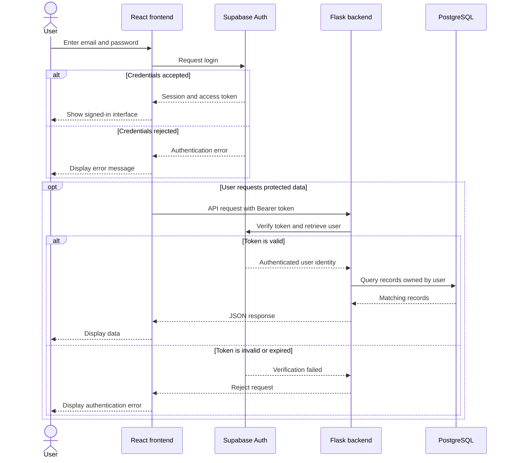
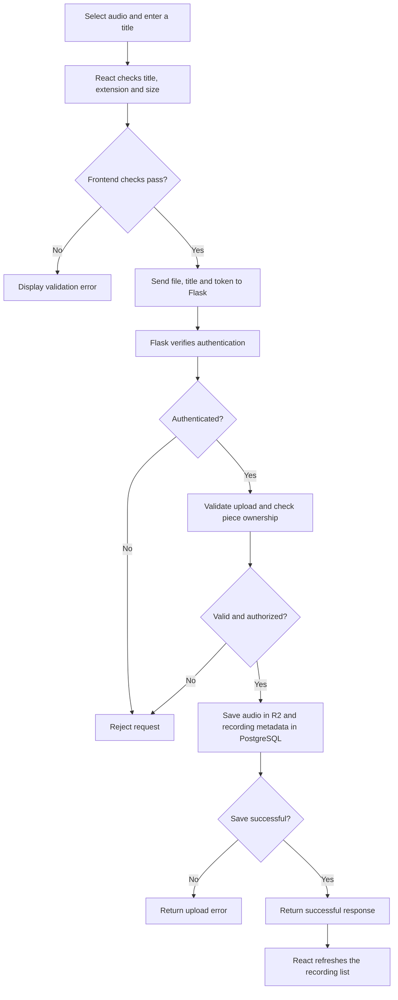
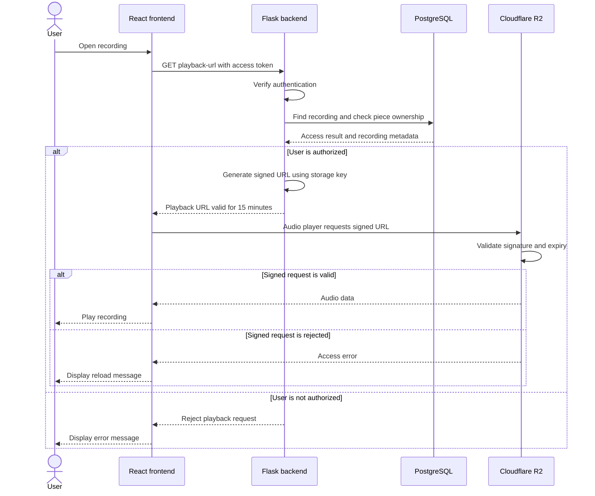
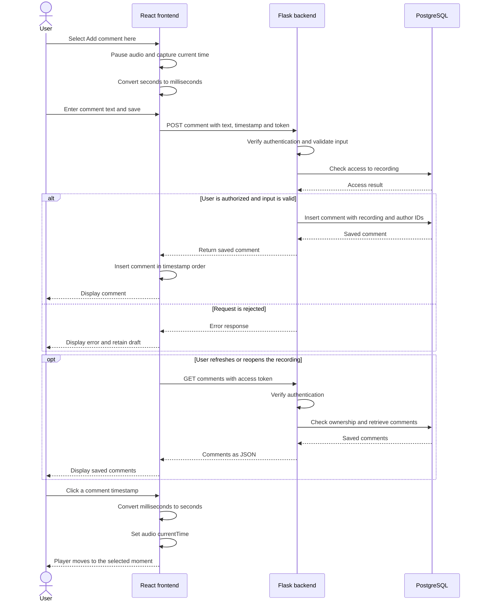

# Application request flows

## Authentication flow

Supabase authenticates the user and returns a session.
React sends the access token with protected API requests.
Flask verifies the token and checks ownership before returning private data.

Authentication identifies the user. Ownership checks determine which
pieces, recordings and comments that user may access.

## Recording upload flow

React sends the audio file and recording title to Flask as form data.
Flask validates the request and checks ownership before saving the upload.

The save step includes two separate operations:
storing the audio in R2 and storing its metadata in PostgreSQL.
These services do not share a single database transaction.

Frontend validation provides immediate feedback.
Backend validation enforces the upload rules.

Upload progress measures transfer from the browser to Flask.
Reaching 100% does not necessarily mean storage and database saving
have finished.

## Audio playback flow

Flask checks access to the recording and generates a signed playback URL
valid for 15 minutes. The browser retrieves the audio directly from R2.

Flask generates the signed URL without downloading the audio.
The R2 bucket remains private.

The expiry limits when the URL can authorize a new request.
It does not guarantee that playback stops exactly 15 minutes
after the URL was issued.

## Timestamped comments flow

React captures the player's current position and converts it from seconds
to milliseconds. Flask validates the request and saves the comment
against the recording and authenticated author.

Selecting an already loaded comment does not require a Flask API request.
The browser updates the player position locally. Seeking may cause
the audio player to request additional audio data from R2.